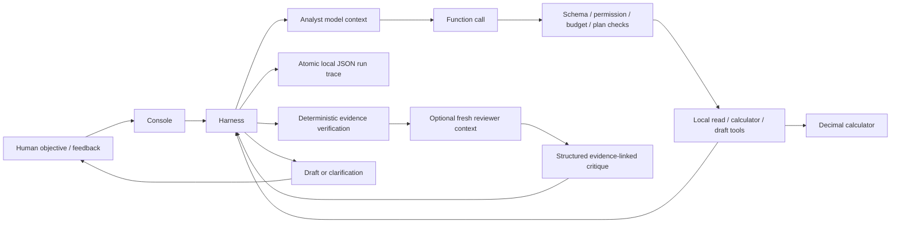

# Architecture

The smallest working shape is a console, a domain library and one application library organized into concrete responsibility folders. There is no web server, database server, agent framework, MCP server or cloud deployment.

## Responsibilities

- `Domain/PricingCalculator.cs`: money, units, failure provision and price formulas. No model or I/O dependencies.
- `Application/Tools`: catalog and provenance checks, strict schemas and typed contracts, bounded argument validation, allowlisted operations, calculation evidence and draft assembly. Costs are always loaded from the catalog, never supplied by model arguments.
- `Application/Models`: a narrow `IModelClient` and OpenAI Responses REST adapter. No implicit SDK retry or server conversation state. Requests replay bounded context with `store=false`. API error bodies are not logged.
- `Application/Harness`: the model/tool/result loop, budgets, cancellation, independent retry/review counts, canonical repeated-call detection, tool result type checks and trace persistence. Each instance owns one run; a continuation is a linked new run.
- `Application/Agents` and `runtime-skills`: trusted versioned procedure files loaded explicitly from two allowlisted paths. Their joint SHA-256 hash is recorded. Reviewer validation checks verdict consistency and JSON pointer existence in the draft.
- `Console`: local configuration, command composition, deterministic report rendering, feedback linkage and live evaluation orchestration.
- `tests`: calculator assertions, scripted harness faults, mocked HTTP adapter tests and a socket-free fallback driver.

## Patterns implemented

**Tool use:** the model chooses calls; the application validates, executes and supplies results. Model output cannot override stored costs, fabricate accepted scenario IDs or gain a price-application capability.

**Reflection:** an independent reviewer receives a fresh context with only the objective and structured draft, and only a `submit_review` tool. It emits approve/revise plus concrete evidence pointers and requested changes. One analyst revision is allowed by default, with at most two reviewer passes. JSON pointer validation makes critiques traceable; it does not prove their correctness. Calculator evidence is reverified independently.

**Planning:** `plan-review` adds an `update_plan` tool that selects the next tool and a brief observable objective. Every following action must match that choice; the choice is consumed, including on errors. Calculation plans require product/rule retrieval, and draft plans require calculation evidence. Missing data can end the run through clarification at any stage. State/preconditions enforce execution; this is a small adaptive next-action planner, not a general autonomous task scheduler.

**Multi-agent collaboration:** analyst and reviewer use separate contexts and restricted roles, potentially the same model. The harness coordinates evidence and feedback. There is no claim of quality improvement until real comparisons exist.

## Trust and limitations

The allowlist exposes discovery, read, calculate, draft, clarification and optional plan operations. It has no external write primitive, so a prompt cannot grant price-application permission. Human approval remains a draft requirement; an approval-to-marketplace workflow is not implemented.

Structured calculator evidence is authoritative for arithmetic. Narrative coverage, source authenticity and review findings still need evaluation/human inspection. Sources and validation statuses are local human-maintained records, not cryptographically authenticated proof. The demo dataset is explicitly synthetic.

A persistent exclusive-lock spend ledger reserves conservative estimated request/output cost before HTTP transmission, using the verified standard rates for the supported model and the authorized USD 2 ceiling. Reservations for unknown usage remain consumed; reported usage settles known costs. This is a local estimate-based control, not an account-wide invoice cap.

Token limits are checked against returned usage and can overshoot in a single response. Unreported usage is flagged. Character bounds protect context size; they are not exact tokenizers. Technical retry budget applies to transient network/429/5xx model failures and is separate from analyst revision budget; model timeouts stop instead of automatically retrying. Read-only tools are cancellation-aware; arbitrary uncooperative side-effecting tools are outside this prototype's guarantees.

Traces are saved after requests/results and finalization, but process termination or filesystem failure can leave an incomplete run. JSON files do not provide database transactions across runs, encryption at rest or multi-user authorization. No production readiness is claimed.

## Why no framework yet?

The direct loop has a small number of explicit tools and gives Heron visible control over validation, budgets and state. The trade-off is owning protocol parsing, resilience and trace persistence. Microsoft Agent Framework remains a candidate if sessions/workflows/integrations justify migration; Semantic Kernel was considered but no dependency is installed merely for familiarity. See the decision log and official sources.
